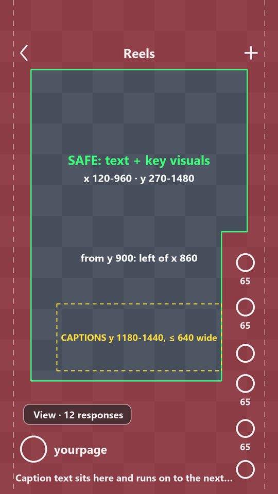

# The safe frame (every 9:16 episode, cover and Story)

Applies to everything this skill makes for a phone: Instagram Reels and trial reels, Stories, YouTube Shorts, TikTok,
covers. The overlay engine is built on these numbers and `final_qa` checks every draft and final against them. If
another guide gives you less padding, this one wins.

Text that hugs the screen edge or sits under the like button is the quickest way for a reel to look amateur on a phone.
Viewers never see your frame the way your monitor shows it.

## Why the edges are not safe

On a tall phone, Instagram fills the screen height with the video and **crops 50-100 px off each side**. Then it draws
its own UI on top of the picture (all numbers in 1080x1920 video pixels, measured from iPhone screenshots):

| Instagram UI | Covers |
|---|---|
| Status bar + "Reels" / "Trial reels" header + back and camera buttons | y 0-250 |
| Like / comment / repost / share / save / more rail | x > ~880, from y ~950 down to ~1840 |
| "View · N responses" pill (trial reels) | x 90-510, y 1570-1650 |
| Profile picture, username, follow button, caption line, audio row | y ~1680-1900, full width |
| Bottom bar ("Insights on Edits", nav) | below the video |

YouTube Shorts and TikTok put their rails, captions and tabs in nearly the same places, so one frame works for all.

## The safe frame (1080x1920)



1. **All text and every key visual** (faces, hands, the thing being shown, logos, panels, HUDs, chips):
   inside **x 120-960, y 270-1480**.
2. **The button rail:** from y 900 down, keep text and faces **left of x 860**.
3. **Captions / subtitles:** lower third, the whole caption block between **y 1180 and 1440**, centred on x 540 and
   **at most 640 px wide** (x 220-860), at most 2 lines.
4. **Top panels, HUDs, titles:** start at **y ≥ 270**. Never use the top 250 px for anything you need to read.
5. **Below y 1480 is background only:** floor, desk, scenery, gradient. No words, no faces, no labels. The trial-reel
   pill, username and caption will sit there.
6. **Sides:** no text, border or panel edge in the outer 120 px. Full-bleed backgrounds are fine; boxed panels need
   ≥ 120 px of air on both sides (so a panel is at most 840 px wide).
7. **Breathing room:** inside the frame, keep ~24 px between text and any panel edge. Nothing kisses a line.

**Stories, posters and still covers** (no video UI rail, but a progress bar, name row and reply bar): text inside
**x 100-980, y 250-1670**. Reel covers also show in the profile grid as a 3:4 crop (y 240-1680), so the title must
read inside that crop.

## How the skill follows it

- **The overlay** (`engine/pipeline/overlay.mjs`, constant `SAFE`): HUD from y 280, x 140-940; story cards slam in a
  640 px panel above y 900; captions sit in the band y 1180-1440 at most 610 px wide (a pop-in never grows them past
  640) and page after 2 rows; the vote stack (title, 600 px pills, "COMMENT 1 · 2 · 3") ends at y 1440 and stays
  left of x 860; the stat card is 640 wide. A caption that has to clear a face moves UP, never below y 1440.
- **The shots** (your job when you write them): faces inside the safe frame, and from y 900 down left of x 860; nothing
  you need to read below y 1480 (legs, floor and scenery are fine there). During the vote keep faces above y 760: the
  vote stack fills y 800-1440. `look` and `stills` previews are full frames: run the checker on them (below).
- **Covers** (`arclab.py covers`): title from y 330, x 130-950, inside the grid crop.
- **final_qa** runs the safe-frame check on every draft and final (`engine/py/safezone.py`):
  1. every overlay frame: no solid pixel outside the safe frame (FAIL);
  2. every caption line inside the band (a line moved up to clear a face is listed, look at it);
  3. every face from the shots' layout data (`out/layout_*.json`, written by full segment renders) inside the safe
     frame (FAIL); a clue outside it is listed for a look;
  4. the contact sheet `out/qa/<file>/safezone.png`: red = no-go areas, white = the app's own buttons, pill and caption.

## How to check by eye (every time, before showing a preview and before the final)

```bash
python <engine>/safezone/check.py <video.mp4 | frame.png | folder of frames> [--every 1.5] [--out sheet.png]
```

It samples frames, paints the no-go areas red, draws Instagram's real buttons, caption and trial pill on top in white,
and writes a contact sheet next to the input (`<name>_safezone.png`). **Open it and look.** Anything you need to read
that sits in red or under a white button is a fix, not a note. Say in the reply that the safe-frame check passed (or
what you fixed).
